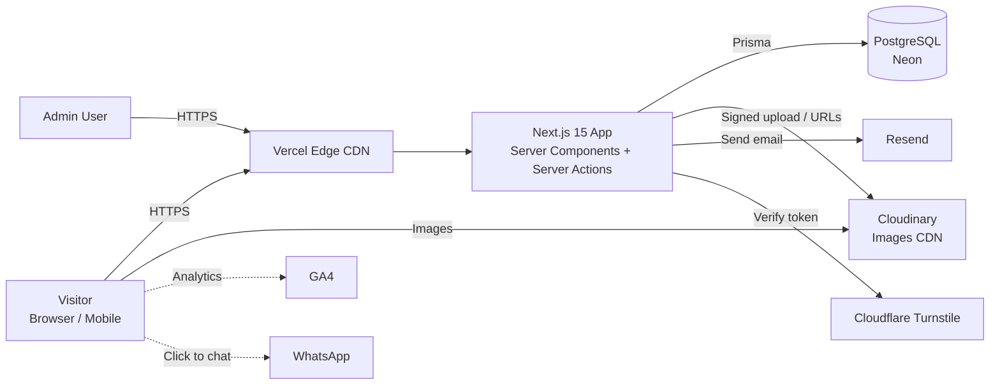
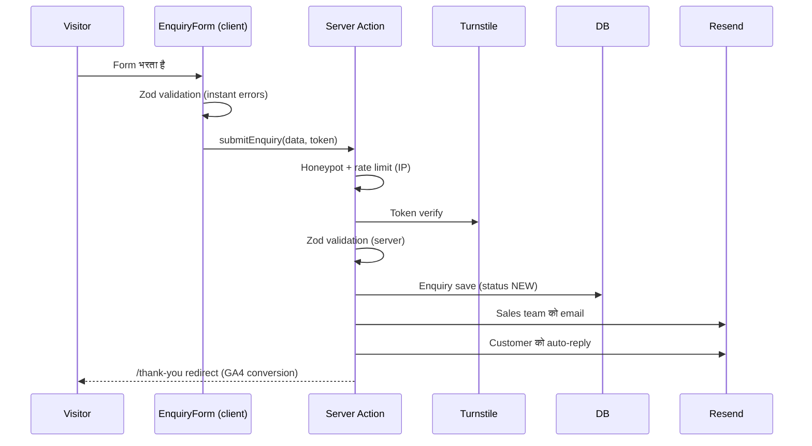

# Insta Mark Website: Architecture Design Document

| | |
|---|---|
| **Version** | 1.0 (Draft for review) |
| **Date** | 12 Oct 2026 |
| **Status** | Phase 0–5 पूरे (13 Oct 2026)। अगला: Phase 6 launch ([launch-checklist.md](launch-checklist.md))। QA के नतीजे: [qa-report.md](qa-report.md)। |
| **Related docs** | [database-design.md](database-design.md), [meeting-summary.md](meeting-summary.md), [chat-history.md](chat-history.md) |

---

## 1. Overview

### 1.1 Project क्या है
Insta Mark एक architectural signage और road safety solutions कंपनी है (design, manufacturing, installation)। यह project उसकी **public company website और एक internal admin panel** है:

- **Website (public):** company profile, 8 product categories, executed projects की photos, enquiry/quote forms
- **Admin panel (internal):** content, photos, projects और enquiries manage करने के लिए

### 1.2 Business goals
1. **Lead generation:** हर page से enquiry आए (category page पर inline form)।
2. **Credibility:** executed projects और client logos से भरोसा बने।
3. **Search visibility:** "signage manufacturer", "speed breaker supplier" जैसी searches पर Google ranking।
4. **Self-service content:** client की team बिना developer के photos और projects add कर सके।

### 1.3 Non-goals (v1 में नहीं)
- Online payment या e-commerce cart
- Customer login या order tracking
- Multi-language (Hindi) version (v2 में हो सकता है)
- Blog (v2 candidate)

### 1.4 Target users (meeting से)
| User | ज़रूरत | Design पर असर |
|---|---|---|
| Site engineers, procurement staff | जल्दी समझना कि कंपनी क्या बनाती है, फिर enquiry भेजना | Simple navigation, बड़ी images, कम text, कोई fancy animation नहीं |
| Architects, developers, builders | Quality और portfolio देखना | Executed project galleries, client logos |
| Insta Mark admin team | Content और leads manage करना | आसान admin panel |

---

## 2. Requirements

### 2.1 Functional
| ID | Requirement |
|---|---|
| F1 | Homepage: Banner → About (short) → Category grid → Working Process → Industries → Client logos → CTA → FAQ |
| F2 | 8 Category pages, सब एक ही template से: Overview, Key Features, Applications, Catalogue images, Executed photos, FAQ, inline Enquiry form |
| F3 | Projects portfolio: list (category और city filter), project detail gallery |
| F4 | About Us page: Who we are, Vision, Mission, Manufacturing capabilities, Process |
| F5 | Contact page: form (Name, Company, Email, Phone, Project Location, Requirement, Message), map, phone, email |
| F6 | Floating WhatsApp और Call buttons (mobile पर ज़रूरी) |
| F7 | Enquiry आने पर sales team को email, customer को auto-reply |
| F8 | Admin: login, categories CRUD, images upload/reorder, projects CRUD, client logos, FAQs, enquiries list और status |
| F9 | Admin में edit के बाद website पर बिना redeploy के update दिखे |

### 2.2 Non-functional
| Area | Target |
|---|---|
| Performance | Lighthouse ≥ 90 (mobile), LCP < 2.5s on 4G, CLS < 0.1 |
| SEO | Indexable server-rendered HTML, structured data, sitemap |
| Accessibility | WCAG 2.1 AA: alt text, contrast, keyboard navigation |
| Security | Admin auth, spam protection, OWASP basics |
| Availability | 99.9% (Vercel + Neon managed) |
| Maintainability | Plain JavaScript, component-based, documented |
| Cost | Launch पर free या low-cost tiers |

---

## 3. Technology Stack (Final)

| Layer | Technology | Reason |
|---|---|---|
| Framework | **Next.js 15 (App Router)**, **JavaScript (no TypeScript)** | SSR/SSG से SEO, frontend और backend एक codebase में |
| UI framework | **Bootstrap 5.3** + **React-Bootstrap** | Reference theme (Crafto) Bootstrap पर बना है, इसलिए grid, spacing और breakpoints वैसे ही मिलेंगे |
| Styling | **Sass (SCSS)**, Bootstrap variables override | Theme जैसे colors, fonts, spacing के design tokens |
| Fonts | Inter (body), Space Grotesk (headings) via `next/font/local` + `@fontsource-variable` (OFL-1.1) | Theme वाले fonts, layout shift नहीं। Google Fonts से build के समय download नहीं होते, इसलिए network flaky होने पर भी build fail नहीं होता। *(Phase 3 में बदला गया)* |
| Animation | **Custom `Reveal`** (IntersectionObserver + CSS, ~1 kB), सिर्फ़ हल्का fade-up | Client ने fancy animation मना किया है। Framer Motion (~30 kB+) की ज़रूरत नहीं पड़ी। *(Implementation में बदला गया)* |
| Carousel | — (अभी नहीं) | Client ने simple UI माँगा है। Logos मिलने पर ज़रूरत हुई तो Swiper जोड़ेंगे। *(Implementation में बदला गया)* |
| Gallery lightbox | **yet-another-react-lightbox** | Executed project photos |
| Icons | **Bootstrap Icons, inline SVG subset** (`npm run icons`) | Bootstrap के साथ consistent। 128 KB का icon font हटाया, जिससे Lighthouse performance 82 से 93–95 पर गई। *(Phase 5 में बदला गया, ADR-16)* |
| Database | **PostgreSQL** on **Neon** | Relational data, free tier, branching |
| ORM | **Prisma** | JS में type-safe-ish queries, migrations |
| Auth (admin) | **Custom**: scrypt password hashes (Node crypto) + HMAC-SHA256 signed session cookie (Web Crypto), `middleware.js` + `requireAdmin()` | कोई third-party dependency नहीं। Auth.js v5 अभी beta है, और हमें सिर्फ़ email/password चाहिए। *(Phase 4 में बदला गया, ADR-13)* |
| Media | **Cloudinary** | Upload, auto format/resize, CDN |
| Forms | **React 19 `useActionState`** + Server Action + **Zod** | Server पर validation, browser में native HTML validation। JS के बिना भी form काम करता है। React Hook Form की ज़रूरत नहीं पड़ी। *(Implementation में बदला गया)* |
| Email | **Resend** | Enquiry notifications |
| Spam protection | **Cloudflare Turnstile** + honeypot + rate limit | Free, invisible captcha |
| Hosting | **Vercel** | Next.js native, preview deployments |
| Analytics | GA4, Google Search Console, Vercel Analytics | Traffic और SEO tracking |
| Version control | Git + GitHub | PR-based workflow |

### 3.1 Bootstrap verification (12 Oct 2026)
Scratchpad में एक throwaway prototype से जाँचा: Next.js 15.5 + Bootstrap 5.3.3 + React-Bootstrap 2.10.5 + Sass।

| Check | Result |
|---|---|
| SCSS variable override (`$primary`, fonts) | ✅ काम करता है |
| `next/font` CSS variables Bootstrap fonts में | ✅ |
| React-Bootstrap `Container/Row/Col` server component में | ✅ |
| React-Bootstrap `Accordion` (`"use client"` के साथ) | ✅ |
| Production build | ✅ Static pages generate हुए, First Load JS ~109 kB |
| Issue: Sass की ~300 deprecation warnings (Bootstrap 5.3 पुराना `@import` syntax use करता है) | ✅ **Fixed:** `next.config.mjs` में `sassOptions.quietDeps: true` और `silenceDeprecations: ["import","global-builtin","color-functions","legacy-js-api"]`। Note: `mixed-decls` flag न डालें, नए Sass में वह obsolete है और warning देता है। |

**Rules (team के लिए):**
- Bootstrap का JS bundle (`bootstrap.bundle.js`) **import नहीं करना**। Interactive components (Navbar collapse, Accordion, Modal, Tabs) सिर्फ़ **React-Bootstrap** से लें। इससे jQuery-style DOM conflicts और SSR errors नहीं आएँगे।
- Interactive component वाली files में सबसे ऊपर `"use client"` लिखें। बाकी सब server components रहें।
- Tailwind और Bootstrap को साथ में **mix नहीं करना**।

---

## 4. High-Level Architecture



**Simple शब्दों में:**
1. Visitor page खोलता है। Vercel CDN से पहले से बना (static/ISR) HTML आता है, इसलिए page तेज़ खुलता है।
2. Images सीधे Cloudinary CDN से आती हैं, auto WebP/AVIF और सही size में।
3. Enquiry form एक **Server Action** को भेजा जाता है। वहाँ validation होता है, data DB में save होता है और email जाता है।
4. Admin कुछ edit करता है, तो data DB में save होता है और `revalidateTag()` से सिर्फ़ वही pages refresh होते हैं।

---

## 5. Rendering & Caching Strategy

| Route | Strategy | Revalidation |
|---|---|---|
| `/` (Home) | Static (SSG) + ISR | Category, project, logo या FAQ edit होने पर tag `home` |
| `/solutions/[slug]` | SSG (`generateStaticParams` से 8 pages) | Tag `category:<slug>` |
| `/projects`, `/projects/[slug]` | SSG + ISR | Tag `projects`, `project:<slug>` |
| `/about`, `/contact` | Static | Content बदलने पर redeploy या tag |
| `/admin/**` | Dynamic (SSR), no cache | — |
| Server Actions (forms) | Dynamic | — |

**Data access layer:** सारी DB queries `lib/data/*.js` में होंगी, `unstable_cache` / `fetch` tags के साथ। Admin की mutation के बाद `revalidateTag()` चलेगा। इससे website हमेशा तेज़ (cached) रहेगी और admin के बदलाव कुछ seconds में दिखेंगे।

---

## 6. Sitemap & Routes

### 6.1 Public
```
/                                   Home
/solutions                          All categories (grid)
/solutions/tailor-made-signage
/solutions/modular-signs
/solutions/general-signs
/solutions/braille-signs
/solutions/fire-safety-signs
/solutions/emergency-lights
/solutions/road-signs
/solutions/road-safety-products
/projects                           Portfolio (filter: category, city)
/projects/[slug]                    Project detail gallery
/about                              About Us
/contact                            Contact + form
/thank-you                          Form submit के बाद (conversion tracking)
/privacy-policy
/sitemap.xml, /robots.txt           Auto-generated
```

### 6.2 Admin (protected) — implemented
```
/admin/login
/admin                              Dashboard (नई enquiries, pipeline, top solutions)
/admin/enquiries                    List, search, filter, pagination
/admin/enquiries/[id]               Detail, status, owner, notes
/admin/enquiries/export             CSV export (route handler)
/admin/categories                   8 categories
/admin/categories/[id]              Text, features, SEO, visibility + photo manager
/admin/projects, /new, /[id]        CRUD + gallery
/admin/clients                      Client logos
/admin/faqs
/admin/settings                     (ADMIN) Phone, email, WhatsApp, address, map, social
/admin/users                        (ADMIN) Users और roles
/admin/audit                        (ADMIN) Audit log
/admin/account                      अपना password बदलना
```

### 6.3 API / Server
| Endpoint | Purpose |
|---|---|
| Server Action `submitEnquiry` | Public forms (contact, category और project pages) |
| Server Actions `lib/admin/actions/*` | Admin CRUD, login/logout। हर action `requireAdmin()` से शुरू होता है। |
| Server Action `getUploadSignature` | Admin upload के लिए signed Cloudinary params। *(पहले `/api/cloudinary/sign` route plan था।)* |
| `GET /admin/enquiries/export` | CSV export (session check) |
| `GET /api/cron/maintenance` | Daily maintenance (`CRON_SECRET`) |

---

## 7. Folder Structure (planned)

```
insta-mark/
├── app/
│   ├── (site)/                      # Public website (shared Header/Footer layout)
│   │   ├── layout.js
│   │   ├── page.js                  # Home
│   │   ├── solutions/
│   │   │   ├── page.js
│   │   │   └── [slug]/page.js       # Category template
│   │   ├── projects/
│   │   │   ├── page.js
│   │   │   └── [slug]/page.js
│   │   ├── about/page.js
│   │   ├── contact/page.js
│   │   └── thank-you/page.js
│   ├── admin/                       # Admin panel (अलग layout, auth protected)
│   │   ├── layout.js
│   │   ├── login/page.js
│   │   ├── page.js
│   │   ├── enquiries/ …
│   │   ├── categories/ …
│   │   ├── projects/ …
│   │   ├── clients/ …
│   │   ├── faqs/ …
│   │   └── settings/ …
│   ├── api/
│   │   ├── auth/[...nextauth]/route.js
│   │   └── cloudinary/sign/route.js
│   ├── layout.js                    # Root: fonts, global SCSS
│   ├── sitemap.js
│   ├── robots.js
│   └── not-found.js
├── components/
│   ├── layout/                      # Header, Footer, MobileMenu, FloatingActions
│   ├── sections/                    # Hero, AboutIntro, CategoryGrid, ProcessSteps,
│   │                                # IndustriesGrid, LogoStrip, FeatureGrid,
│   │                                # ImageWithList, Gallery, FaqAccordion, CtaBanner
│   ├── forms/                       # EnquiryForm, fields
│   ├── ui/                          # SectionHeading, Button, Eyebrow, StatBadge
│   └── admin/                       # DataTable, ImageUploader, SortableList
├── lib/
│   ├── db.js                        # Prisma client singleton
│   ├── data/                        # Read queries (cached, tagged)
│   ├── actions/                     # Server actions (enquiry, admin CRUD)
│   ├── validation/                  # Zod schemas
│   ├── auth.js                      # Auth.js config
│   ├── cloudinary.js
│   ├── email/                       # Resend + email templates
│   └── seo.js                       # Metadata + JSON-LD helpers
├── content/                         # Static copy (About, Process) अगर DB में न हो
├── styles/
│   ├── _variables.scss              # Design tokens (Bootstrap overrides)
│   ├── _typography.scss
│   ├── _components.scss
│   └── globals.scss
├── prisma/
│   ├── schema.prisma
│   ├── migrations/
│   └── seed.js                      # Content PDF का data
├── public/                          # favicon, logo SVG, og-image
├── middleware.js                    # /admin protection
├── next.config.mjs                  # sassOptions, images.remotePatterns
├── .env.example
└── docs/
```

**Conventions:**
- Files: components `PascalCase.jsx`, बाकी `kebab-case.js`
- Server components default रहेंगे। `"use client"` सिर्फ़ interactive leaf components में।
- Business logic `lib/` में रहेगा, components सिर्फ़ UI के लिए।
- ESLint + Prettier, और Husky pre-commit hook।

---

## 8. Design System (Crafto से inspired, Option A)

> **License note:** Crafto theme का design सिर्फ़ reference है। Theme का code, CSS, JS या images copy नहीं होंगे। Layout pattern और style हम अपने code में Bootstrap से दोबारा बनाएँगे।

### 8.1 Tokens (`styles/_variables.scss`)
| Token | Value | Note |
|---|---|---|
| `$body-bg` | `#ffffff` | Client को white चाहिए (theme cream है) |
| `$body-color` | `#1d1d1d` | |
| `$secondary` (muted text) | `#7b7a7a` | |
| `$primary` (accent) | **TBD: Insta Mark logo color** | Logo मिलने तक `#e99022` placeholder |
| Fonts | Inter (body), Space Grotesk (headings) | |
| Section spacing | `py-6` / `py-lg-8` (custom spacers) | Theme जैसी खुली spacing |
| Container | `max-width: 1320px` (xxl) | |
| Radius | 0–4px | Theme का sharp, professional look |

### 8.2 Theme section से Insta Mark component mapping
| Crafto section | Our component | कहाँ use होगा |
|---|---|---|
| Split hero (heading + 2 images) | `Hero` | Home, Category |
| Eyebrow + big heading | `SectionHeading` | हर जगह |
| "15 Years" badge | `StatBadge` | Home About, Category |
| 4-column features | `FeatureGrid` | Category: Key Features |
| Image + bullet list | `ImageWithList` | Category: Applications |
| Portfolio grid | `CategoryGrid`, `Gallery` | Home, Category, Projects |
| Process steps 01–04 | `ProcessSteps` | Home, About |
| Client logos row | `LogoStrip` | Home, Category |
| FAQ accordion | `FaqAccordion` | Home, Category |
| Contact CTA | `CtaBanner` + `EnquiryForm` | हर page का end |
| ❌ Video popup, rating metrics, 3D tilt (Atropos) | **हटाए गए** | Client का निर्देश |

### 8.3 Page wireframes (text)

**Home**
```
[Header: Logo | Solutions ▾ | Projects | About | Contact | (Get a Quote)]
[Hero: "Signage That Guides. Safety That Lasts." + subtext + 2 CTAs + image]
[About: 2 lines + StatBadge]
[Our Solutions: 8 category cards (image + name) → /solutions/slug]
[Working Process: 01 Survey · 02 Design · 03 Manufacture · 04 Install]
[Industries We Serve: icon grid (12)]
[Trusted by: LogoStrip]
[CTA: "Let's Build Smarter Spaces Together."]
[FAQ]
[Footer]
```

**Category (template, जैसे Tailor-made Signage)**
```
[Breadcrumb]
[Hero: Category name + Overview + 2 images]
[Key Features: FeatureGrid]
[Applications: ImageWithList]
[Our Products: catalogue images gallery]
[Executed Projects: real site photos gallery (lightbox)]
[FAQ (category specific, optional)]
[Enquiry Form: inline, category pre-selected]
```

---

## 9. Data Model

> **पूरा design, Prisma schema (code), ER diagram, indexes, seed data और verification report:** [database-design.md](database-design.md)

**Summary:** PostgreSQL 16 (Neon) + Prisma 6.19। **15 tables, 4 enums, 26 indexes** (2 migrations)। Schema `prisma validate` से validate हुआ और असली Postgres engine (PGlite) पर constraint tests 12/12 pass हुए।

| Group | Tables |
|---|---|
| Catalogue | `categories`, `category_images` (`CATALOGUE` / `EXECUTED`), `industries`, `faqs` |
| Portfolio | `projects`, `project_images`, `project_categories` (M:N), `client_logos` |
| Media | `media_assets` (Cloudinary metadata, single source for every image) |
| Leads | `enquiries` (status pipeline + UTM attribution), `enquiry_notes` |
| Admin | `admin_users` (`ADMIN` / `EDITOR`), `audit_logs` |
| Ops | `site_settings` (key-value), `rate_limits` (Redis के बिना spam protection) |

**Key design decisions:**
- Images की binary DB में नहीं रहती। `media_assets` में Cloudinary `public_id`, `width/height` (CLS से बचने के लिए) और required `alt` रहते हैं।
- Category delete होने पर भी enquiries बची रहती हैं (`SET NULL`)। Use हो रही image delete नहीं हो सकती (`RESTRICT`)।
- Enquiry पहले DB में save होती है, उसके बाद email जाता है, इसलिए lead कभी loss नहीं होती (`notified_at` से retry)।
- Visitor का raw IP store नहीं होता, सिर्फ़ salted hash (privacy)।
- `cuid()` IDs, और `snake_case` tables और columns।

---

## 10. Key Flows

### 10.1 Enquiry submission

- Email fail होने पर भी enquiry DB में save रहेगी, यानी lead कभी loss नहीं होगी।
- Category page से आने पर `categoryId` और `sourcePage` अपने-आप भर जाएँगे।

### 10.2 Admin image upload
1. Admin, `ImageUploader` में files चुनता है।
2. Browser `/api/cloudinary/sign` से signature लेता है (सिर्फ़ logged-in admin को मिलता है)।
3. Browser सीधे Cloudinary पर upload करता है, server पर load नहीं पड़ता।
4. Server Action `publicId`, size और alt text DB में save करता है, फिर `revalidateTag('category:<slug>')` चलाता है।
5. Drag-and-drop से order बदलता है और `sortOrder` update होता है।

Cloudinary folder structure: `insta-mark/categories/<slug>/{catalogue|executed}/`, `insta-mark/projects/<slug>/`, `insta-mark/clients/`

### 10.3 Content update
Admin edit करता है, Server Action (auth check, Zod) चलता है, DB update होता है, `revalidateTag` चलता है, और कुछ seconds में website पर नया content दिखता है। Redeploy की ज़रूरत नहीं।

---

## 11. SEO Strategy
- हर page पर `generateMetadata`: title, description, canonical, Open Graph और Twitter card।
- **Structured data (JSON-LD):** `Organization` और `LocalBusiness` (Home), `Service` (Category pages), `FAQPage` (FAQ sections), `BreadcrumbList`।
- `app/sitemap.js` DB से dynamic sitemap बनाएगा (categories और projects)। `robots.js` में `/admin` disallow।
- Clean slugs: `/solutions/road-safety-products`
- Images पर meaningful `alt` अनिवार्य (admin में required field)।
- Category pages पर local keywords, जैसे "Signage manufacturer in Mumbai"।
- **पुरानी website के URLs** (अगर कोई है) के लिए `next.config.mjs` में 301 redirects, ताकि ranking न गिरे।
- Google Search Console verify करके sitemap submit करना।

## 12. Performance
- Images: Cloudinary `f_auto,q_auto` + `next/image` `sizes` + lazy loading। Hero image पर `priority`।
- Fonts: `next/font/local` से variable woff2 files (self-hosted, `display: swap`)।
- CSS: Bootstrap SCSS में से सिर्फ़ ज़रूरी modules import करें (जैसे carousel, toasts, popovers नहीं)।
- JS: Client components कम रखें। Lightbox `next/dynamic` से lazy load होता है (सिर्फ़ photo खोलने पर)। Measured: हर page का first-load JS 103–121 kB।
- Budget: First Load JS < 150 kB per page, hero image < 200 kB।

## 13. Security
| Risk | Mitigation |
|---|---|
| Admin access | scrypt password hashes, HMAC-signed HttpOnly + SameSite=Lax cookie (8 घंटे)। `middleware.js` signature check करता है, और हर page व Server Action में `requireAdmin()` DB से user की जाँच करता है (inactive user तुरंत बाहर)। Password बदलने पर बाकी सारे sessions invalid हो जाते हैं। Roles: ADMIN और EDITOR। |
| Brute force login | IP rate limit (10 tries / 10 मिनट), 5 failures पर account 15 मिनट के लिए lock। Unknown email पर भी एक जैसा error और एक जैसा समय (enumeration नहीं)। `next` redirect सिर्फ़ `/admin` के अंदर। |
| Admin data exports | CSV cells formula injection (`=`, `+`, `-`, `@`) से neutralised। Export audit log में दर्ज। |
| Admin uploads | Browser सीधे Cloudinary पर upload करता है। Signed params में `folder` और `allowed_formats` होते हैं, और response का signature server पर verify होने के बाद ही DB में जाता है। |
| Accountability | हर admin create, update और delete `audit_logs` में (1 साल तक)। |
| Spam enquiries | Turnstile + honeypot field + IP rate limit (5 per 10 min)। Cloudflare token reject करे तो block। Cloudflare तक पहुँच ही न हो तो एक retry के बाद lead accept, warning log के साथ। |
| Injection | Prisma parameterized queries, Zod validation |
| XSS | React escaping, rich text नहीं (plain text + line breaks) |
| Secrets | सिर्फ़ Vercel env vars में, `.env` git में नहीं, `.env.example` commit होगी |
| Uploads | Signed Cloudinary uploads, file type/size limit (images, ≤ 10 MB) |
| Headers | CSP, `X-Frame-Options`, `Referrer-Policy` via `next.config.mjs` headers |
| Data privacy | Privacy policy page, enquiry data सिर्फ़ admin देख सकें |

## 14. Accessibility
- Semantic HTML (header, nav, main, footer), सही heading order
- Color contrast ≥ 4.5:1 (accent color तय करते समय check)
- Keyboard navigation (React-Bootstrap components accessible हैं)
- Form labels, error messages `aria-live` के साथ
- `prefers-reduced-motion` पर animation बंद

---

## 15. Environments & Deployment

| Environment | Branch | URL | Database |
|---|---|---|---|
| Local | any | `localhost:3000` | Neon dev branch या local Postgres 16 (इस machine पर install है) |
| Preview | PR branches | `*.vercel.app` (auto) | Neon preview branch |
| Production | `main` | `www.instamark.in` (TBD) | Neon main |

**CI/CD:** GitHub PR बनता है, Vercel preview deploy होता है, review होता है, merge to `main` होता है, फिर production deploy। Prisma migrations `prisma migrate deploy` से build step में चलेंगे।

**Environment variables:** पूरी और current list [`.env.example`](../.env.example) में है, और हर variable का असर README → Configuration में। WhatsApp और phone अब env में नहीं, admin की Site settings में रहते हैं।

**Backups:** Neon point-in-time restore। हर हफ़्ते enquiries का CSV export, admin से।
**Monitoring:** Vercel Analytics, GA4 conversions (`/thank-you`), Search Console। Sentry optional।

---

## 16. Content Migration Plan
| Source | Destination | तरीका |
|---|---|---|
| `Website_Content_Insta_Mark.pdf` (text) | Category, Faq, Industry tables + `content/` | `prisma/seed.js` |
| Drive: Modular Signs, Road Safety, Tailor-made folders | Cloudinary + CategoryImage/ProjectImage | एक बार का upload script, फिर admin से sorting |
| Client का catalogue PDF | Catalogue images | Client से high-res export |
| Client logos (पुरानी website से) | ClientLogo | Manual upload |
| Category-wise sorted executed photos | CategoryImage (`EXECUTED`) | Client और Shivani के sorting session के बाद |

---

## 17. Delivery Phases (estimate)

| Phase | Scope | Duration (approx) |
|---|---|---|
| **0. Setup** | Repo, Next.js + Bootstrap + Sass, ESLint/Prettier, Prisma + Neon, Vercel, env | 2–3 दिन |
| **1. Design system** | SCSS tokens, typography, Header/Footer, सभी section components | 1 हफ़्ता |
| **2. Public pages** | Home, Category template (8), About, Contact, Projects, static data के साथ | 1.5 हफ़्ते |
| **3. Backend** | DB schema, seed, enquiry flow (Turnstile, Resend), data layer और caching | 1 हफ़्ता |
| **4. Admin panel** | Auth, enquiries, categories, images upload, projects, logos, FAQs, settings | 1.5 हफ़्ते |
| **5. SEO & QA** | Metadata, JSON-LD, sitemap, performance, accessibility, cross-browser और mobile testing | 3–4 दिन |
| **6. Launch** | Content migration, domain/DNS, Search Console, client training, handover | 2–3 दिन |
| **Total** | | **लगभग 6–7 हफ़्ते** (1 developer, content समय पर मिले तो) |

**Client review points:** Phase 1 के बाद (design approval), Phase 2 के बाद (preview link), और launch से पहले।

---

## 18. Risks & Open Questions

| # | Item | Impact | Owner |
|---|---|---|---|
| 1 | Category-wise sorted high-res photos अभी नहीं मिले | Category pages अधूरे रहेंगे | Client + Shivani |
| 2 | Insta Mark logo (SVG) और brand color तय नहीं | Design tokens pending | Client |
| 3 | Domain और पुरानी website के URLs | Redirects और SEO | Client |
| 4 | Drive folder `1e1R0hHf…` private है | Content गायब हो सकता है | User |
| 5 | Prices दिखानी हैं या सिर्फ़ quote? (अभी: सिर्फ़ quote) | Scope | Client |
| 6 | Sales team का enquiry email और WhatsApp number | Notifications | Client |
| 7 | AI-generated images तभी, जब real photos न हों | Authenticity | Agency |

---

## 19. Architecture Decision Records (ADR)

| # | Decision | Alternatives | Reason |
|---|---|---|---|
| ADR-1 | **Next.js** (React + Node.js) | React SPA + Express | SEO, एक codebase, image optimization |
| ADR-2 | **JavaScript** | TypeScript | User/team की पसंद |
| ADR-3 | **PostgreSQL + Prisma** | MongoDB | Relational data, reporting आसान |
| ADR-4 | **Custom admin panel** | Payload CMS | Payload TypeScript-first है |
| ADR-5 | **Bootstrap 5.3 + React-Bootstrap + Sass** | Tailwind + shadcn/ui | Reference theme Bootstrap पर बना है, prototype build pass हुआ (Section 3.1) |
| ADR-6 | **Option A:** theme से inspired design, अपना code | Crafto license खरीदकर convert करना | Licensing साफ़, React-native code, jQuery नहीं |
| ADR-7 | **Cloudinary** for media | Vercel Blob, S3 | Auto transformation, बड़ी image library |
| ADR-8 | **Server Actions** for forms और admin | अलग REST API | कम code, built-in CSRF protection |
| ADR-9 | **Dual data source**: `DATABASE_URL` हो तो Prisma, वरना `/content` | सिर्फ़ DB | Database के बिना भी local, CI और preview builds चलते हैं। Pages का code एक ही रहता है। |
| ADR-10 | **Turnstile outage पर fail-open** (rejection पर fail-closed) | हमेशा fail-closed | B2B में एक असली lead खोना एक spam से ज़्यादा महंगा है। Honeypot और rate limit फिर भी लागू रहते हैं। |
| ADR-11 | **Self-hosted fonts** | `next/font/google` | Build को Google Fonts की availability पर निर्भर नहीं रहना चाहिए। Phase 3 testing में flaky network से build fail हुआ था। |
| ADR-12 | **Seed = create-missing** (overwrite सिर्फ़ opt-in) | हर run पर overwrite | Admin के edits re-seed करने पर मिटने नहीं चाहिए। |
| ADR-13 | **Custom auth** (scrypt + HMAC cookie) | Auth.js v5, bcrypt | सिर्फ़ email/password चाहिए। Auth.js v5 beta है। Zero dependencies (उस समय npm registry भी unreachable था)। Lockout, role checks और session invalidation पूरी तरह हमारे control में। 14 unit tests। |
| ADR-14 | **ISR pages पर `dynamicParams = false` नहीं** | Unknown slugs के लिए `dynamicParams=false` | Next.js 15 में `revalidateTag` के बाद NoFallbackError आता है और page 404 देने लगता है (E2E test में पकड़ा गया)। Unknown slugs के लिए `notFound()` use करते हैं। |
| ADR-16 | **Icon font की जगह generated inline SVG** (server: पूरा set, client: छोटा subset, CSS: SVG mask) | `bootstrap-icons` web font | 128 KB का font + ~2000 classes वाली CSS हर page पर render-blocking थी। Lighthouse: FCP 2.6s से 1.6s, performance 82 से 93–95। Admin का category icon free text से curated dropdown बना। |
| ADR-15 | **Admin forms `onSubmit` से submit होते हैं** (`ActionForm`) | `<form action={…}>` | React 19 हर action के बाद form reset करता है, error पर भी, जिससे admin का भरा data मिट जाता था (E2E test में पकड़ा गया)। Reset सिर्फ़ success पर होता है। Public enquiry form values को खुद echo करता है, इसलिए वह JS के बिना भी काम करता है। |
