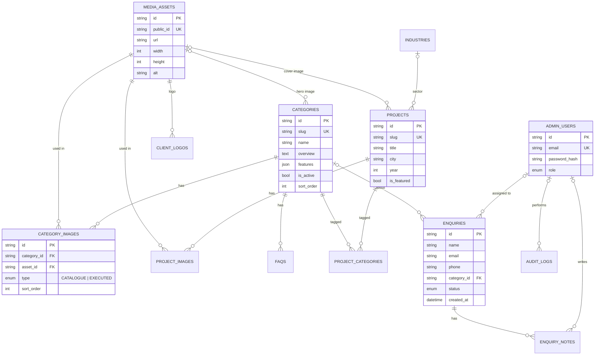

# Insta Mark Website: Database Design

| | |
|---|---|
| **Version** | 1.0 (Draft for review) |
| **Date** | 12 Oct 2026 |
| **Database** | PostgreSQL 16 (Neon, managed) |
| **ORM** | Prisma 6.19 (JavaScript) |
| **Status** | Schema design हो गया और validate हो गया (Section 10)। Project में code अभी नहीं डाला गया है। |
| **Related** | [architecture.md](architecture.md) (Section 9) |

> Development शुरू होने पर Section 4 का schema जैसा है वैसा ही `prisma/schema.prisma` में जाएगा, और पहली migration `prisma migrate dev --name init` से बनेगी।

---

## 1. Design Principles

| Principle | इस schema में कैसे |
|---|---|
| **Single source for media** | हर image `media_assets` में एक बार रहती है। Category, project और logo सिर्फ़ उसका reference रखते हैं, duplicate URL नहीं। |
| **Leads कभी loss न हों** | Enquiry की category delete हो जाए तो भी enquiry रहती है (`SET NULL`)। Hard delete की जगह status `SPAM` होता है। |
| **Safe deletes** | जो image कहीं use हो रही है, वह delete नहीं हो सकती (`RESTRICT`)। Category delete करने पर उसकी images, FAQs और project links अपने-आप हट जाते हैं (`CASCADE`)। |
| **Soft visibility** | `is_active` से content छिपाया जा सकता है, delete करने की ज़रूरत नहीं। |
| **Admin-controlled order** | हर list में `sort_order`, ताकि admin drag-drop से order बदल सके। |
| **Privacy by design** | Visitor का raw IP store नहीं होता, सिर्फ़ `ip_hash` (SHA-256 + secret salt)। |
| **Postgres conventions** | Tables `snake_case` plural, columns `snake_case`। Raw SQL और reporting आसान रहती है। |
| **Non-guessable IDs** | `cuid()` string IDs। Admin URLs में sequential numbers नहीं दिखते। |
| **Auditability** | Admin के हर create, update और delete का record `audit_logs` में रहता है। |

---

## 2. Entity Overview

| Group | Table | Purpose | Expected rows (year 1) |
|---|---|---|---|
| Catalogue | `categories` | 8 product categories (Tailor-made, Modular…) | 8–12 |
| | `category_images` | Category की catalogue और executed photos | 300–800 |
| | `industries` | Industries We Serve (12) | 12–20 |
| | `faqs` | Global और category-specific FAQs | 20–60 |
| Portfolio | `projects` | Executed projects (जैसे CCI Tower, Kandivali) | 30–150 |
| | `project_images` | Project gallery | 500–2,000 |
| | `project_categories` | Project ↔ Category (many-to-many) | 50–300 |
| | `client_logos` | "Trusted by" logos | 10–40 |
| Media | `media_assets` | Cloudinary images का metadata | 1,000–3,000 |
| Leads | `enquiries` | Website forms से आए leads | 500–5,000 |
| | `enquiry_notes` | Sales team का follow-up history | 1,000+ |
| Admin | `admin_users` | Admin और editor accounts | 2–5 |
| | `audit_logs` | Admin actions का record | 5,000+ |
| Ops | `site_settings` | Phone, WhatsApp, email, address, socials | ~10 |
| | `rate_limits` | Form और login spam protection | Rolling (purge होता रहेगा) |

**Total: 15 tables, 4 enums, 26 indexes।** (Migration 2 ने `CategoryGroup` enum जोड़ा।) Data छोटा है, इसलिए Neon का free tier (0.5 GB) सालों तक काफ़ी है। Images का असली data Cloudinary पर रहता है।

---

## 3. ER Diagram



### Delete behaviour (referential actions)
| जब यह delete हो… | तो… | Rule |
|---|---|---|
| Category | उसकी `category_images`, `faqs`, `project_categories` हट जाते हैं। **Enquiries बची रहती हैं** (`category_id = NULL`)। Projects बचे रहते हैं। | CASCADE / SET NULL |
| Project | उसकी `project_images` और `project_categories` हट जाते हैं | CASCADE |
| Media asset जो कहीं use हो रहा है | **Delete blocked**, पहले उसे जहाँ use हो रहा है वहाँ से हटाना होगा | RESTRICT |
| Hero या cover image | Category या project बचा रहता है, image field खाली हो जाता है | SET NULL |
| Enquiry | उसके notes हट जाते हैं | CASCADE |
| Admin user | Notes, audit logs और assignments बचे रहते हैं (author/actor NULL) | SET NULL |

> Practice में admin users और enquiries delete नहीं करेंगे, सिर्फ़ `is_active = false` या status `SPAM`।

---

## 4. Prisma Schema (complete, validated)

**File (development में):** `prisma/schema.prisma`

```prisma
// Insta Mark: database schema (PostgreSQL, Prisma 6)
// Conventions: tables snake_case plural (@@map), columns snake_case (@map),
// ids = cuid strings; editable tables have created_at + updated_at.

generator client {
  provider = "prisma-client-js"
}

datasource db {
  provider  = "postgresql"
  url       = env("DATABASE_URL") // Neon pooled connection (app runtime)
  directUrl = env("DIRECT_URL") // Neon direct connection (migrations)
}

// ───────────────────────────── Enums ─────────────────────────────

enum AdminRole {
  ADMIN // full access incl. users & settings
  EDITOR // content + enquiries, no users/settings
}

enum CategoryGroup {
  ARCHITECTURAL // "Architectural Signage"
  ROAD_SAFETY // "Road Safety Solutions"
}

enum ImageType {
  CATALOGUE // product profile images from the catalogue
  EXECUTED // real photos from executed sites
}

enum EnquiryStatus {
  NEW
  CONTACTED
  QUOTED
  WON
  LOST
  SPAM
}

// ─────────────────────────── Admin & audit ───────────────────────────

model AdminUser {
  id               String    @id @default(cuid())
  name             String    @db.VarChar(100)
  email            String    @unique @db.VarChar(255)
  passwordHash     String    @map("password_hash")
  role             AdminRole @default(EDITOR)
  isActive         Boolean   @default(true) @map("is_active")
  failedLoginCount Int       @default(0) @map("failed_login_count")
  lockedUntil      DateTime? @map("locked_until")
  lastLoginAt      DateTime? @map("last_login_at")
  createdAt        DateTime  @default(now()) @map("created_at")
  updatedAt        DateTime  @updatedAt @map("updated_at")

  assignedEnquiries Enquiry[]     @relation("EnquiryAssignee")
  enquiryNotes      EnquiryNote[]
  auditLogs         AuditLog[]

  @@map("admin_users")
}

model AuditLog {
  id        String   @id @default(cuid())
  actorId   String?  @map("actor_id")
  action    String   @db.VarChar(50) // e.g. CREATE, UPDATE, DELETE, LOGIN
  entity    String   @db.VarChar(50) // e.g. Category, Project, Enquiry
  entityId  String?  @map("entity_id")
  changes   Json? // { field: [old, new] }
  createdAt DateTime @default(now()) @map("created_at")

  actor AdminUser? @relation(fields: [actorId], references: [id], onDelete: SetNull)

  @@index([entity, entityId])
  @@index([createdAt])
  @@map("audit_logs")
}

// ───────────────────────────── Media ─────────────────────────────

/// Single source of truth for every uploaded image (stored on Cloudinary).
model MediaAsset {
  id        String   @id @default(cuid())
  publicId  String   @unique @map("public_id") // Cloudinary public_id
  url       String // secure_url
  width     Int
  height    Int
  format    String   @db.VarChar(10)
  bytes     Int
  alt       String   @db.VarChar(255) // required for SEO & a11y
  createdAt DateTime @default(now()) @map("created_at")
  updatedAt DateTime @updatedAt @map("updated_at")

  categoryHeroes Category[]      @relation("CategoryHero")
  categoryImages CategoryImage[]
  projectCovers  Project[]       @relation("ProjectCover")
  projectImages  ProjectImage[]
  clientLogos    ClientLogo[]

  @@map("media_assets")
}

// ──────────────────────────── Catalogue ────────────────────────────

model Category {
  id               String        @id @default(cuid())
  slug             String        @unique @db.VarChar(100)
  name             String        @db.VarChar(100)
  shortDescription String        @map("short_description") @db.VarChar(300) // card text on home grid
  group            CategoryGroup @default(ARCHITECTURAL) @map("category_group") // mega menu column
  icon             String?       @db.VarChar(50) // bootstrap-icons name, e.g. "fire"
  overview         String        @db.Text
  features         Json          @default("[]") // string[]: "Key Features"
  applications     String        @db.Text
  heroImageId      String?       @map("hero_image_id")
  sortOrder        Int           @default(0) @map("sort_order")
  isActive         Boolean       @default(true) @map("is_active")
  seoTitle         String?       @map("seo_title") @db.VarChar(70)
  seoDescription   String?       @map("seo_description") @db.VarChar(160)
  createdAt        DateTime      @default(now()) @map("created_at")
  updatedAt        DateTime      @updatedAt @map("updated_at")

  heroImage MediaAsset?       @relation("CategoryHero", fields: [heroImageId], references: [id], onDelete: SetNull)
  images    CategoryImage[]
  projects  ProjectCategory[]
  faqs      Faq[]
  enquiries Enquiry[]

  @@index([isActive, sortOrder])
  @@map("categories")
}

model CategoryImage {
  id         String    @id @default(cuid())
  categoryId String    @map("category_id")
  assetId    String    @map("asset_id")
  type       ImageType
  caption    String?   @db.VarChar(200)
  sortOrder  Int       @default(0) @map("sort_order")
  createdAt  DateTime  @default(now()) @map("created_at")
  updatedAt  DateTime  @updatedAt @map("updated_at")

  category Category   @relation(fields: [categoryId], references: [id], onDelete: Cascade)
  asset    MediaAsset @relation(fields: [assetId], references: [id], onDelete: Restrict)

  @@unique([categoryId, assetId])
  @@index([categoryId, type, sortOrder])
  @@map("category_images")
}

model Industry {
  id          String   @id @default(cuid())
  slug        String   @unique @db.VarChar(100)
  name        String   @db.VarChar(100)
  icon        String?  @db.VarChar(50) // bootstrap-icons name, e.g. "hospital"
  description String?  @db.VarChar(300)
  sortOrder   Int      @default(0) @map("sort_order")
  isActive    Boolean  @default(true) @map("is_active")
  createdAt   DateTime @default(now()) @map("created_at")
  updatedAt   DateTime @updatedAt @map("updated_at")

  projects Project[]

  @@index([isActive, sortOrder])
  @@map("industries")
}

// ──────────────────────────── Portfolio ────────────────────────────

model Project {
  id           String   @id @default(cuid())
  slug         String   @unique @db.VarChar(150)
  title        String   @db.VarChar(150)
  clientName   String?  @map("client_name") @db.VarChar(150)
  city         String?  @db.VarChar(100)
  state        String?  @db.VarChar(100)
  year         Int?
  description  String?  @db.Text
  industryId   String?  @map("industry_id")
  coverImageId String?  @map("cover_image_id")
  isFeatured   Boolean  @default(false) @map("is_featured")
  isActive     Boolean  @default(true) @map("is_active")
  sortOrder    Int      @default(0) @map("sort_order")
  createdAt    DateTime @default(now()) @map("created_at")
  updatedAt    DateTime @updatedAt @map("updated_at")

  industry   Industry?         @relation(fields: [industryId], references: [id], onDelete: SetNull)
  coverImage MediaAsset?       @relation("ProjectCover", fields: [coverImageId], references: [id], onDelete: SetNull)
  images     ProjectImage[]
  categories ProjectCategory[]

  @@index([isActive, isFeatured, sortOrder])
  @@index([city])
  @@index([industryId])
  @@map("projects")
}

model ProjectImage {
  id        String   @id @default(cuid())
  projectId String   @map("project_id")
  assetId   String   @map("asset_id")
  caption   String?  @db.VarChar(200)
  sortOrder Int      @default(0) @map("sort_order")
  createdAt DateTime @default(now()) @map("created_at")
  updatedAt DateTime @updatedAt @map("updated_at")

  project Project    @relation(fields: [projectId], references: [id], onDelete: Cascade)
  asset   MediaAsset @relation(fields: [assetId], references: [id], onDelete: Restrict)

  @@unique([projectId, assetId])
  @@index([projectId, sortOrder])
  @@map("project_images")
}

/// Many-to-many: one project can use several product categories.
model ProjectCategory {
  projectId  String   @map("project_id")
  categoryId String   @map("category_id")
  createdAt  DateTime @default(now()) @map("created_at")

  project  Project  @relation(fields: [projectId], references: [id], onDelete: Cascade)
  category Category @relation(fields: [categoryId], references: [id], onDelete: Cascade)

  @@id([projectId, categoryId])
  @@index([categoryId])
  @@map("project_categories")
}

model ClientLogo {
  id         String   @id @default(cuid())
  name       String   @db.VarChar(150)
  websiteUrl String?  @map("website_url")
  logoId     String   @map("logo_id")
  sortOrder  Int      @default(0) @map("sort_order")
  isActive   Boolean  @default(true) @map("is_active")
  createdAt  DateTime @default(now()) @map("created_at")
  updatedAt  DateTime @updatedAt @map("updated_at")

  logo MediaAsset @relation(fields: [logoId], references: [id], onDelete: Restrict)

  @@index([isActive, sortOrder])
  @@map("client_logos")
}

model Faq {
  id         String   @id @default(cuid())
  question   String   @db.VarChar(300)
  answer     String   @db.Text
  categoryId String?  @map("category_id") // null = global FAQ
  showOnHome Boolean  @default(false) @map("show_on_home")
  sortOrder  Int      @default(0) @map("sort_order")
  isActive   Boolean  @default(true) @map("is_active")
  createdAt  DateTime @default(now()) @map("created_at")
  updatedAt  DateTime @updatedAt @map("updated_at")

  category Category? @relation(fields: [categoryId], references: [id], onDelete: Cascade)

  @@index([categoryId, isActive, sortOrder])
  @@map("faqs")
}

// ──────────────────────────── Leads ────────────────────────────

model Enquiry {
  id              String        @id @default(cuid())
  name            String        @db.VarChar(100)
  company         String?       @db.VarChar(150)
  email           String        @db.VarChar(255)
  phone           String        @db.VarChar(20) // stored as E.164, e.g. +919876543210
  projectLocation String?       @map("project_location") @db.VarChar(150)
  requirement     String?       @db.VarChar(150)
  message         String?       @db.Text
  categoryId      String?       @map("category_id")
  status          EnquiryStatus @default(NEW)
  assignedToId    String?       @map("assigned_to_id")
  // Attribution
  sourcePage      String?       @map("source_page") @db.VarChar(255)
  utmSource       String?       @map("utm_source") @db.VarChar(100)
  utmMedium       String?       @map("utm_medium") @db.VarChar(100)
  utmCampaign     String?       @map("utm_campaign") @db.VarChar(100)
  // Anti-spam / ops (no raw IP stored: privacy)
  ipHash          String?       @map("ip_hash") @db.VarChar(64)
  userAgent       String?       @map("user_agent") @db.VarChar(255)
  notifiedAt      DateTime?     @map("notified_at") // sales email sent
  createdAt       DateTime      @default(now()) @map("created_at")
  updatedAt       DateTime      @updatedAt @map("updated_at")

  category   Category?     @relation(fields: [categoryId], references: [id], onDelete: SetNull)
  assignedTo AdminUser?    @relation("EnquiryAssignee", fields: [assignedToId], references: [id], onDelete: SetNull)
  notes      EnquiryNote[]

  @@index([status, createdAt(sort: Desc)])
  @@index([createdAt(sort: Desc)])
  @@index([categoryId])
  @@index([email])
  @@index([assignedToId])
  @@map("enquiries")
}

model EnquiryNote {
  id        String   @id @default(cuid())
  enquiryId String   @map("enquiry_id")
  authorId  String?  @map("author_id")
  body      String   @db.Text
  createdAt DateTime @default(now()) @map("created_at")

  enquiry Enquiry    @relation(fields: [enquiryId], references: [id], onDelete: Cascade)
  author  AdminUser? @relation(fields: [authorId], references: [id], onDelete: SetNull)

  @@index([enquiryId, createdAt])
  @@map("enquiry_notes")
}

// ──────────────────────────── Ops ────────────────────────────

/// Key-value site settings: phone, whatsapp, email, address, socials.
model SiteSetting {
  key       String   @id @db.VarChar(100)
  value     Json
  updatedAt DateTime @updatedAt @map("updated_at")

  @@map("site_settings")
}

/// Fixed-window rate limiting without Redis (enquiry form, admin login).
model RateLimit {
  key         String   @db.VarChar(150) // e.g. "enquiry:<ipHash>", "login:<email>"
  windowStart DateTime @map("window_start")
  count       Int      @default(1)

  @@id([key, windowStart])
  @@index([windowStart])
  @@map("rate_limits")
}
```

---

## 5. Data Dictionary (important fields)

### `categories`
| Column | Type | Rule |
|---|---|---|
| `slug` | varchar(100), unique | URL में use होता है: `/solutions/<slug>`। Lowercase और hyphen। Launch के बाद **बदलना नहीं** (SEO)। |
| `short_description` | varchar(300) | Home grid card का 1-line text |
| `category_group` | enum `ARCHITECTURAL` / `ROAD_SAFETY` | Mega-menu का column (Migration 2)। Column का नाम `group` नहीं रखा, क्योंकि वह SQL reserved word है। |
| `icon` | varchar(50), nullable | Bootstrap Icons का नाम (जैसे `fire`)। Photo न होने पर placeholder में दिखता है। (Migration 2) |
| `overview` | text | Content PDF का "Overview" |
| `features` | jsonb, default `[]` | `["Custom Design", "Premium Materials", …]` (Key Features)। Zod से `string[]` validate। |
| `applications` | text | Content PDF का "Applications" |
| `hero_image_id` | FK → media_assets, nullable | Category hero image |
| `seo_title` / `seo_description` | varchar(70) / (160) | खाली हों तो `name` और `short_description` fallback |

### `category_images`
| Column | Type | Rule |
|---|---|---|
| `type` | enum `CATALOGUE` / `EXECUTED` | Meeting का decision: catalogue images और site photos अलग sections में |
| `sort_order` | int | Gallery का क्रम |
| unique `(category_id, asset_id)` | | एक ही photo एक category में दो बार नहीं आ सकती |

### `media_assets`
| Column | Type | Rule |
|---|---|---|
| `public_id` | unique | Cloudinary ID। Transformation URLs इसी से बनते हैं। |
| `width`, `height` | int | `next/image` को देते हैं, ताकि layout shift (CLS) न हो |
| `alt` | varchar(255), **required** | SEO और accessibility। Admin upload में ज़रूरी field। |

### `enquiries`
| Column | Type | Rule |
|---|---|---|
| `name`, `email`, `phone` | required | Contact PDF के fields। Email lowercase में store। |
| `phone` | varchar(20) | **E.164** में normalize (`+919876543210`), Zod से |
| `company`, `project_location`, `requirement`, `message` | optional | |
| `category_id` | FK, nullable | Category page के form से अपने-आप भरता है |
| `status` | enum, default `NEW` | `NEW → CONTACTED → QUOTED → WON / LOST`, या `SPAM` |
| `source_page`, `utm_*` | | कौन-से page या campaign से lead आई (marketing ROI) |
| `ip_hash` | varchar(64) | `sha256(ip + IP_HASH_SALT)`। Raw IP कभी store नहीं होता। |
| `notified_at` | nullable | Sales email जाने का समय। NULL हो तो retry job फिर से भेजेगा। |

### `site_settings` (keys)
| Key | Example value |
|---|---|
| `contact.phone` | `"+91 98XXXXXXXX"` |
| `contact.whatsapp` | `"919XXXXXXXXX"` |
| `contact.email` | `"sales@…"` |
| `contact.address` | `{ "line1": "…", "city": "Mumbai", "mapUrl": "…" }` |
| `enquiry.notifyEmails` | `["sales@…", "owner@…"]` |
| `social` | `{ "linkedin": "…", "instagram": "…" }` |
| `stats` | `{ "yearsExperience": 15, "projectsDone": 500 }` (Hero/About badges) |

---

## 6. Indexes & Query Patterns

| Index | किस query के लिए |
|---|---|
| `categories (is_active, sort_order)` | Home grid और menu: active categories क्रम से |
| `category_images (category_id, type, sort_order)` | Category page: catalogue और executed galleries |
| `projects (is_active, is_featured, sort_order)` | Home "Featured Projects", Projects list |
| `projects (city)`, `projects (industry_id)` | Projects page filters |
| `project_categories (category_id)` | "इस category के projects" (reverse lookup) |
| `faqs (category_id, is_active, sort_order)` | Category FAQs, global FAQs (`category_id IS NULL`) |
| `enquiries (status, created_at DESC)` | Admin: "New enquiries, latest first" (सबसे ज़्यादा use होने वाली screen) |
| `enquiries (created_at DESC)` | Dashboard counts, CSV export by date |
| `enquiries (email)` | Repeat customer पहचानना |
| `enquiries (category_id)`, `(assigned_to_id)` | Reports: category-wise leads, मेरे assigned leads |
| `audit_logs (entity, entity_id)` | "इस category को किसने और कब बदला" |
| `rate_limits (window_start)` | पुराने rows की cleanup |

### Example queries (implementation reference)

**Category page (एक query में पूरा data):**
```js
// lib/data/categories.js
export async function getCategoryPage(slug) {
  return prisma.category.findFirst({
    where: { slug, isActive: true },
    include: {
      heroImage: true,
      images: { orderBy: { sortOrder: "asc" }, include: { asset: true } },
      faqs: { where: { isActive: true }, orderBy: { sortOrder: "asc" } },
      projects: {
        where: { project: { isActive: true } },
        include: { project: { include: { coverImage: true } } },
        take: 6,
      },
    },
  });
}
// Page component में: images.filter(i => i.type === "CATALOGUE") / "EXECUTED"
```

**Enquiry save (email fail होने पर भी lead save रहे):**
```js
// lib/actions/enquiry.js  ("use server")
const enquiry = await prisma.enquiry.create({ data: validated }); // 1. पहले save
try {
  await sendSalesEmail(enquiry);                                   // 2. फिर email
  await prisma.enquiry.update({ where: { id: enquiry.id }, data: { notifiedAt: new Date() } });
} catch (err) {
  console.error("Enquiry email failed", enquiry.id, err);          // notifiedAt NULL रहेगा, retry job भेज देगा
}
```

**Gallery reorder (atomic):**
```js
await prisma.$transaction(
  orderedIds.map((id, index) =>
    prisma.categoryImage.update({ where: { id }, data: { sortOrder: index } })
  )
);
```

**Admin enquiries list (pagination):**
```js
prisma.enquiry.findMany({
  where: { status: filterStatus ?? undefined },
  orderBy: { createdAt: "desc" },
  take: 25,
  skip: (page - 1) * 25,
  include: { category: { select: { name: true } }, assignedTo: { select: { name: true } } },
});
```

---

## 7. Seed Data (`prisma/seed.js`)

Content PDF (`Website_Content_Insta_Mark.pdf`) से initial data:

### Categories (8)
| sort | slug | name |
|---|---|---|
| 1 | `tailor-made-signage` | Tailor-made Signage |
| 2 | `modular-signs` | Modular Signs |
| 3 | `general-signs` | General Signs |
| 4 | `braille-signs` | Braille Signs |
| 5 | `fire-safety-signs` | Fire & Safety Signs |
| 6 | `emergency-lights` | Emergency Lights |
| 7 | `road-signs` | Road Signs |
| 8 | `road-safety-products` | Road Safety Products |

हर category का `overview`, `features[]`, `applications` और CTA text PDF से लिया जाएगा।

### Industries (12, Home page list के अनुसार)
Commercial Buildings, Residential Townships, Healthcare, Airports, Railways, Shopping Malls, Hospitality, Educational Institutions, Financial Institutions, Warehousing, Manufacturing Facilities, Government & Infrastructure

> About Us page की list में "Manufacturing Facilities" की जगह "Industrial Facilities" लिखा है। Client से एक नाम confirm करना है।

### FAQs (5, global, `show_on_home = true`)
PDF के FAQ section से: manufacture types, custom signage, industries, installation, why choose Insta Mark।

### Admin
पहला `ADMIN` user Phase 4 में Auth.js के साथ env variables (`SEED_ADMIN_EMAIL`, `SEED_ADMIN_PASSWORD`) से बनेगा। Password code में कभी नहीं लिखना।

**Rules (implemented और verified):**
- Seed **idempotent** है (`upsert` by slug/key/stable id), यानी बार-बार चलाने पर duplicate नहीं बनते।
- Default mode **create-missing** है: मौजूदा rows नहीं बदलतीं, इसलिए admin panel के edits re-seed के बाद भी बचे रहते हैं। `SEED_OVERWRITE=true` देने पर categories, industries और FAQs पर `/content` का text फिर से लिख दिया जाता है।
- Photos किसी category में तभी डाली जाती हैं जब उसमें एक भी photo न हो। Cloudinary migration के बाद asset ids बदल जाती हैं, इसलिए यह नियम duplicates से बचाता है।
- `site_settings` कभी overwrite नहीं होतीं।

---

## 8. Migrations & Environments

**Migrations (`prisma/migrations/`):**

| # | Name | Change |
|---|---|---|
| 1 | `20261013000000_init` | सभी 15 tables, 3 enums, 26 indexes |
| 2 | `20261013120000_category_group_icon` | `CategoryGroup` enum, `categories.category_group` (default `ARCHITECTURAL`), `categories.icon`। Additive है, मौजूदा data सुरक्षित रहता है। |

| Rule | Detail |
|---|---|
| Local development | `npx prisma migrate dev --name <change>`। Migration file Git में commit होती है। |
| Production | Vercel build में `prisma migrate deploy` (सिर्फ़ pending migrations चलती हैं) |
| Preview (PR) | Neon **branch** database, ताकि production data को कोई risk न हो |
| Connections | `DATABASE_URL` = Neon **pooled** URL (`-pooler` host, app के लिए)। `DIRECT_URL` = direct URL (migrations के लिए)। |
| Applied migration | **कभी edit नहीं करना।** बदलाव के लिए नई migration बनानी है। |
| Destructive changes (column drop/rename) | 2-step: (1) नया column + code दोनों पढ़े, (2) अगली release में पुराना हटाएँ |
| Prisma version | **6.19.x pin।** Prisma 7 में config का तरीका बदल गया है, इसलिए upgrade बाद में अलग task के रूप में होगा। |

---

## 9. Data Retention, Backup & Privacy

| Data | Retention | Mechanism |
|---|---|---|
| Enquiries (real) | 3 साल | उसके बाद anonymize (name, email, phone हटाकर) |
| Enquiries (`SPAM`) | 90 दिन | Daily Vercel Cron job से purge |
| `rate_limits` | 24 घंटे | Daily cron |
| `audit_logs` | 1 साल | Monthly cron |
| Backups | Neon point-in-time restore (plan के हिसाब से), और हर हफ़्ते admin से enquiries का CSV export | |
| Personal data access | सिर्फ़ logged-in admins। Logs में email या phone print नहीं होंगे। | |

Privacy policy page पर बताया जाएगा कि enquiry data किस काम के लिए और कितने समय तक रखा जाता है (India का DPDP Act 2023 ध्यान में रखते हुए)।

---

## 10. Verification Report (12 Oct 2026)

Schema को project में डालने से पहले scratchpad में throwaway setup पर test किया गया:

| Check | Tool | Result |
|---|---|---|
| Schema syntax और relations | `prisma validate` (6.19.3) | ✅ Valid |
| Formatting | `prisma format` | ✅ |
| Client generation | `prisma generate` | ✅ |
| SQL DDL generation | `prisma migrate diff --from-empty` | ✅ 360 lines: 15 tables, 26 indexes, 3 enums |
| असली PostgreSQL पर apply | PGlite (embedded Postgres engine) | ✅ सारी tables बनीं |

**Constraint tests (PGlite पर, 12/12 PASS):**

| # | Test | Result |
|---|---|---|
| 1 | Category defaults (`features = []`, `is_active = true`) | ✅ |
| 2 | Duplicate category slug blocked | ✅ |
| 3 | एक ही image एक category में दो बार blocked | ✅ |
| 4 | गलत `ImageType` value blocked | ✅ |
| 5 | Use हो रही image delete blocked (RESTRICT) | ✅ |
| 6 | Enquiry default status `NEW` | ✅ |
| 7 | Category delete पर enquiry बची रहती है (SET NULL) | ✅ |
| 8 | Category delete पर उसकी images हटती हैं (CASCADE) | ✅ |
| 9 | Category delete पर project links हटते हैं | ✅ |
| 10 | Project ख़ुद बचा रहता है | ✅ |
| 11 | Category की FAQs हटती हैं | ✅ |
| 12 | Unused image delete हो सकती है | ✅ |

> Local PostgreSQL 16 (इस machine पर) password माँगता है, इसलिए उस पर test नहीं किया। Development setup के समय Neon dev branch या local Postgres पर `migrate dev` चलाकर दोबारा verify करना है।

---

## 11. Open Points

| # | Question | Impact |
|---|---|---|
| 1 | Industry का नाम "Manufacturing Facilities" रखें या "Industrial Facilities"? | Seed data |
| 2 | Products individually दिखाने हैं (नाम, specs, price)? अभी design **category-level** है, जैसा meeting में तय हुआ। ज़रूरत हुई तो `products` table बाद में बिना breaking change के जुड़ सकती है। | Future scope |
| 3 | Enquiry form में file attachment (drawing या photo) चाहिए? चाहिए तो `enquiries.attachment_asset_id` जोड़ना होगा। | Form + Cloudinary |
| 4 | कितने admin users होंगे, और कौन किस role में? | Seed और roles |
| 5 | Enquiry notification किन emails पर जाए? | `site_settings` |
